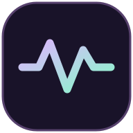

<p align="center"></p>

# QuickWave

Персональная волна в боковой панели Spotify Desktop через Spicetify. QuickWave подбирает следующий трек, показывает его обложку и объясняет выбор.

[Скачать релиз](https://github.com/stasspasjuk-rgb/QuickWave/releases/latest) · [Telegram](https://t.me/QuickDeveloper_bot)


## Установка на Windows

1. Установи [Spotify Desktop](https://www.spotify.com/download/windows/) и [Spicetify](https://spicetify.app/docs/getting-started).
2. Убедись, что Spicetify уже применён к Spotify. При первой настройке Spicetify используй его инструкцию.
3. Открой обычный PowerShell и вставь весь блок.

```powershell
$installer = Join-Path $env:TEMP ('QuickWave-' + [guid]::NewGuid() + '.ps1')
try {
    Invoke-WebRequest -UseBasicParsing 'https://github.com/stasspasjuk-rgb/QuickWave/releases/latest/download/Update-QuickWave.ps1' -OutFile $installer -ErrorAction Stop
    powershell.exe -NoProfile -ExecutionPolicy Bypass -File $installer -Install
} finally {
    if (Test-Path -LiteralPath $installer) { Remove-Item -LiteralPath $installer -Force }
}
```

4. Перезапусти Spotify. Открой **QuickWave** в боковой панели.

Если приложение пропало после обновления Spotify, проверь совместимость версий Spotify и Spicetify и заново примени настройки Spicetify.

## Использование

- **Включить волну** пополняет обычную очередь Spotify по одному треку. Настройки настроения, вкуса и жанров влияют на следующий выбор.
- **Настроить** открывает вкладки «Настроение», «Жанры», «Профиль» и «Ещё». Во вкладке «Ещё» находятся оформление, Telegram, волна по песне и обновления.
- **Волна по песне** включает подборку по текущему треку.
- **Оформление** открывает окно предпросмотра тем, фона и своего цвета волны. Нажми «Применить», чтобы сохранить выбор. На паузе форма волны остаётся на месте. Фигура движется в такт при доступных данных о ритме и громкости. Для остальных треков используется плавная анимация. Настройка уменьшения движения в системе учитывается.
- **Проверить обновления** находится в «Настроить» → «Ещё». При запуске Spotify QuickWave читает файл версии из репозитория и сообщает об обновлении. Для перехода с 2.4.5 и ниже запусти установку из README один раз. При наличии версии выбери **Обновить** или **Позже**. На Windows установленный помощник сверяет SHA-256, применяет обновление и перезапускает Spotify.


Кнопка с четырьмя уголками вверху справа включает полноэкранный режим. Повторное нажатие или Escape возвращает обычный вид.

## Устройства

| Устройство | Поддержка |
| --- | --- |
| Windows, Spotify Desktop + Spicetify | Custom App, установка и скрытый помощник обновлений |
| macOS и Linux, Spotify Desktop + Spicetify | Ручная установка. Совместимость клиента отдельно не проверена |
| Android, iOS, веб-плеер | Custom App не поддерживается |

При ручной установке распакуй ZIP, скопируй папку `quickwave` в папку `CustomApps` рядом с файлом, который показывает `spicetify -c`, затем выполни `spicetify config custom_apps quickwave` и `spicetify apply`. На macOS и Linux обновляй файлы тем же способом.

## Как подбираются треки

QuickWave ищет кандидатов в медиатеке и подборках Spotify. Жанр и настроение учитываются по тематике найденных подборок. Лайки и длительные прослушивания увеличивают вес знакомого звучания, ранние пропуски снижают оценку, а недавние треки и артисты получают штраф. Профиль хранится в клиенте. Сбор сигналов можно выключить и очистить историю на странице QuickWave.

Приложение использует функции настольного клиента через Spicetify. Доступность отдельных функций зависит от версии Spotify, региона и аккаунта. [Пользовательские правила Spotify](https://www.spotify.com/us/legal/user-guidelines/)
