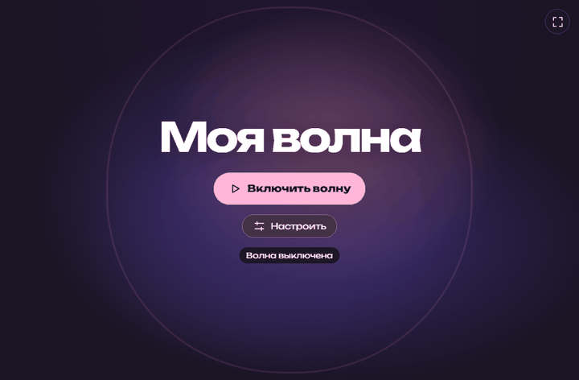

<p align="center"></p>

# QuickWave 2.5.2

Персональная волна в Spotify Desktop через Spicetify. Запускай подбор с главного экрана, меняй настроение и жанры в боковой панели или разворачивай волну на весь экран.

[Релиз 2.5.2](https://github.com/stasspasjuk-rgb/QuickWave/releases/tag/v2.5.2) · [Скачать ZIP](https://github.com/stasspasjuk-rgb/QuickWave/releases/download/v2.5.2/QuickWave-CustomApp.zip) · [Telegram](https://t.me/QuickDeveloper_bot)


## Настройки в действии

Выбор жанров и смена цветовой темы с предпросмотром.



*Интерфейс показан на демонстрационном профиле.*

## Установка и обновление на Windows

1. Установи [Spotify Desktop](https://www.spotify.com/download/windows/) и настрой [Spicetify](https://spicetify.app/docs/getting-started).
2. Вставь весь блок в PowerShell. Он установит актуальный релиз и зарегистрирует скрытый помощник обновлений.

```powershell
$installer = Join-Path $env:TEMP ('QuickWave-' + [guid]::NewGuid() + '.ps1')
try {
    Invoke-WebRequest -UseBasicParsing 'https://github.com/stasspasjuk-rgb/QuickWave/releases/download/v2.5.2/Update-QuickWave.ps1' -OutFile $installer -ErrorAction Stop
    powershell.exe -NoProfile -ExecutionPolicy Bypass -File $installer -Install
    if ($LASTEXITCODE -ne 0) { throw 'Установка QuickWave не завершилась' }
} finally {
    if (Test-Path -LiteralPath $installer) { Remove-Item -LiteralPath $installer -Force }
}
```

3. Перезапусти Spotify и открой **QuickWave** в боковой панели.

При переходе с 2.4.5 или более ранней версии выполни этот блок один раз. Он заменит старый помощник, который обращался к GitHub REST API и мог получать ошибку лимита. Новый читает файл версии из репозитория и сверяет SHA-256 ZIP перед установкой. Окно PowerShell после установки можно закрыть. Чтобы получить шкалу этапов установки и пятисекундный отсчёт до перезапуска при обновлениях, один раз установи 2.5.2 этим способом.

## macOS и Linux

Установи Spotify Desktop и [настрой Spicetify для своей системы](https://spicetify.app/docs/getting-started). Затем вставь в терминал:

```sh
qw_installer=$(mktemp)
if curl -fsSL https://github.com/stasspasjuk-rgb/QuickWave/releases/latest/download/install.sh -o "$qw_installer"; then
  sh "$qw_installer"
fi
rm -f "$qw_installer"
```

Открой **QuickWave** в боковой панели Spotify. Для обновления выполни ту же команду. Кнопка проверки обновлений в приложении покажет новую версию и откроет эту инструкцию. Скрипт проверяет SHA-256 ZIP и берёт путь установки из `spicetify -c`.

## Интерфейс

В «Настроить → Поиск» результаты появляются внутри QuickWave. Рядом с треком можно запустить воспроизведение или волну по песне. Эта команда также доступна по правому клику на треке в Spotify. Цвет и форма плавно меняются по меткам текущего трека, даже когда подбор выключен. На ударе бита загорается кольцо. Если Spotify не отдаёт метки бита, свечение остаётся статичным.

- **Включить волну** добавляет треки по одному в обычную очередь Spotify. Очередь доступна через штатную кнопку плеера.
- **Настроить** открывает панель справа. Карточки настроения и жанров подсвечиваются анимированными градиентами.
- **Кнопка с уголками** вверху справа включает полноэкранный режим. Повторное нажатие или **Esc** возвращает обычный вид.

| Вкладка | Что в ней |
| --- | --- |
| **Настроение** | Настроение и режим вкуса — баланс, знакомое или открытия. |
| **Жанры** | Иллюстрированные карточки жанров. Можно выбрать до пяти, включая свои. |
| **Профиль** | Статистика локального профиля, переключатель сбора прослушиваний и сброс истории. |
| **Ещё** | Волна по текущей песне, предпросмотр тем, фона и цвета волны, Telegram и проверка обновлений. |

Изменения настроения, вкуса и жанров влияют на следующий подбор. Волна пульсирует по меткам бита, если клиент Spotify их предоставляет, и замирает на паузе.

## Следующие обновления

Открой **Настроить → Ещё → Проверить обновления**. Если доступен новый релиз, выбери **Обновить** или **Позже**. На Windows помощник применит обновление и перезапустит Spotify после подтверждения.

## Совместимость и ручная установка

| Устройство | Поддержка |
| --- | --- |
| Windows, Spotify Desktop + Spicetify | Установка через PowerShell и обновление из приложения |
| macOS и Linux, Spotify Desktop + Spicetify | Установка и обновление через терминал |
| Android, iOS и веб-плеер | Custom App не поддерживается |

Для ручной установки распакуй ZIP и скопируй папку `quickwave` в `CustomApps` рядом с конфигурацией, путь к которой показывает `spicetify -c`. Затем выполни:

```sh
spicetify config custom_apps quickwave
spicetify apply
```

## Как работает подбор

QuickWave ищет кандидатов в медиатеке и тематических подборках Spotify. Лайки и долгие прослушивания увеличивают вес знакомого звучания. В счётчик попадают треки, у которых фактически прослушано не менее 75% длительности. Ранние пропуски снижают оценку, а недавно звучавшие треки и артисты получают меньший приоритет. Профиль хранится в клиенте и управляется во вкладке **Профиль**.

Доступность отдельных функций зависит от версии Spotify, региона и аккаунта. [Пользовательские правила Spotify](https://www.spotify.com/us/legal/user-guidelines/)
