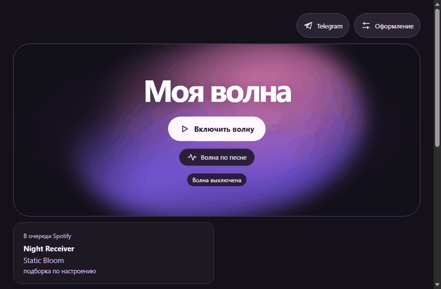

# QuickWave для Spicetify

QuickWave открывается внутри Spotify Desktop из боковой панели. Подбор учитывает жанры, настроение и оценки в самом QuickWave.

[Скачать ZIP](https://github.com/stasspasjuk-rgb/QuickWave/releases/latest/download/QuickWave-Spicetify.zip) · [История версий](https://github.com/stasspasjuk-rgb/QuickWave/releases)

| Подбор и оценки (2.0) | Темы и оформление (2.0) |
| --- | --- |
|  |  |

GIF показывают тот же интерфейс на демонстрационных данных.

## Установка на Windows

Установи [Spicetify](https://spicetify.app/docs/getting-started), затем вставь этот блок в PowerShell.

```powershell
$installer = Join-Path $env:TEMP 'Update-QuickWave.ps1'
Invoke-WebRequest -UseBasicParsing 'https://github.com/stasspasjuk-rgb/QuickWave/releases/latest/download/Update-QuickWave.ps1' -OutFile $installer -ErrorAction Stop
powershell.exe -NoProfile -ExecutionPolicy Bypass -File $installer -Install
```

Перезапусти Spotify и открой **QuickWave** в боковой панели. Установщик один раз регистрирует скрытую задачу Windows. После этого закрой PowerShell. При каждом запуске Spotify помощник проверяет GitHub. Если есть обновление, оно скачивается и применяется в фоне. Новая версия загрузится при следующем запуске Spotify.

Вручную можно распаковать ZIP, скопировать папку `quickwave` в `CustomApps` рядом с файлом из `spicetify -c`, затем выполнить `spicetify config custom_apps quickwave` и `spicetify apply`. Для фонового обновления выполни установку из PowerShell один раз.

## Волна по песне

Включи песню, зайди в QuickWave и нажми **Волна по песне**. QuickWave берёт текущий трек, показывает совпадения из своего каталога и пытается открыть штатное радио трека через меню Spotify. Если клиент не даёт открыть это меню автоматически, нажми **Открыть трек в Spotify** и выбери радио через **⋯**. Подборка **Моя подборка** обновляется на месте.

## Возможности

- **Настройки** дают четыре темы, свой акцент, компактные карточки и переключатель анимации.
- **Подбор** использует вручную размеченный каталог из 81 трека в 21 жанре. Оценки влияют на вес исполнителя, жанра и настроения. Свои треки можно добавлять из раздела «Жанры».
- **Открыть в Spotify** переводит на обычный поиск внутри клиента, если доступна навигация Spicetify.

## Данные и совместимость

QuickWave хранит оценки и оформление локально. Для подбора он использует свой каталог и ручные оценки. Приложение не читает историю аккаунта, не использует Spotify API и не управляет очередью. Spicetify меняет настольный клиент, поэтому совместимость и допустимость зависят от версии клиента и условий Spotify.

[Правила Spotify для разработчиков](https://developer.spotify.com/policy) · [Пользовательские правила Spotify](https://www.spotify.com/us/legal/user-guidelines/)
